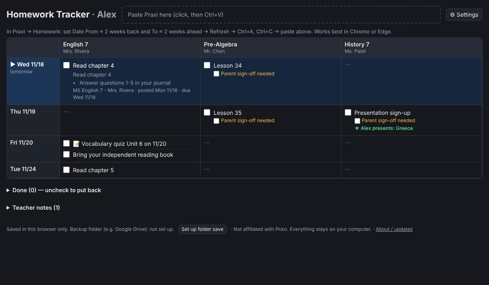

# Homework Tracker for Praxi

Paste your student's Praxi **Homework** page and get everything in one grid: classes across the top, due dates down the side. Check things off as they're done, see what's due next, and stop scrolling through two weeks of teacher posts.

**▶ Open it: https://ricobert1.github.io/praxi-homework-tracker/**



> Not affiliated with or endorsed by Praxi. This is a parent-made helper. It reads only what you paste into it, and everything stays on your computer.

## Getting started (about 30 seconds)

1. Open the link above in **Google Chrome** or **Microsoft Edge** (Mac or Windows) and bookmark it.
2. The first time, enter your student's name the way it appears on class sign-up sheets. This is only used to find their row in presentation sign-ups.
3. In Praxi, go to **Homework**. Set **Date From** to about 2 weeks ago and **To** to about 2 weeks ahead, then click **Refresh**.
4. Select the whole page and copy it (**⌘A, ⌘C** on Mac, **Ctrl+A, Ctrl+C** on Windows).
5. Click the paste box in the tracker and paste (**⌘V** / **Ctrl+V**).

Paste again whenever you like (daily, or a few times a week). Overlapping pastes are fine, because the newest version of each list wins.

## What it does

- **One grid** of every class by due date. The next school day is highlighted, and after 3 pm "next" rolls over to tomorrow.
- **Checkboxes** that stick between visits. Finished items move to a *Done* list, and you can uncheck one to bring it back.
- **Overdue row** at the top, with a one-click "mark everything before this date done" for catching up.
- **Teacher changes**: if a teacher edits an assignment after it was checked off, it comes back flagged so you can re-read it.
- **Moved dates**: flags an item that reappears with a later due date.
- **Tests and quizzes** are pulled out of the text and marked 📝, including "this Friday" / "next Tuesday" wording.
- **Presentation sign-ups**: highlights your student's row and fades the ones that aren't theirs.
- **Parent signature checkbox**: in ⚙ Settings, pick the classes where every assignment needs a parent signature, plus whether presentations do.
- **Print list / Print calendar**: a one-page landscape checklist of the grid, or a two-week Mon–Sat wall calendar (homework in orange, papers and presentations in green, 📝 tests).
- **Teacher notes** ("no homework tonight", etc.) are collected in one place.
- **Up to 8+ classes**: columns narrow to fit, and the date column stays put if you scroll sideways.

## Where your data lives

- By default, everything is saved **in your browser** on that computer. Nothing is sent anywhere, and there is no account or server.
- **Optional backup / sync:** click **Set up folder save** at the bottom and pick a folder, for example one inside **Google Drive for Desktop**, iCloud Drive or OneDrive. The tracker then saves a small `praxi-homework-save.json` file there automatically. Choose the same folder on another computer and the two merge. This needs Chrome or Edge.
- Clearing your browser's site data erases the in-browser copy. The folder copy, if set up, brings it back.

## Prefer a local copy?

Download [`index.html`](https://raw.githubusercontent.com/ricobert1/praxi-homework-tracker/main/index.html) (right-click → *Save Link As…*) and open it in Chrome or Edge. It's a single file with no installs. You can also `git clone https://github.com/ricobert1/praxi-homework-tracker.git`.

Note that the hosted link and a local file keep **separate** saved data, because browsers treat them as different sites. Pick one, or use folder save to keep them in sync.

## Known limits

- It's tuned to how teachers at our school format their Praxi posts. The basic layout (an *Assigned* date, a *Class - Teacher* line, and *Due* headings) is Praxi's own, so it should work elsewhere. Unusual formats may land under **No due date** or get missed. If something parses wrong, use the **Raise an issue** button at the bottom of the page (or [open an issue](https://github.com/ricobert1/praxi-homework-tracker/issues/new)). Cover or crop out student names in any screenshots.
- Safari and Firefox work for the tracker itself, but not for folder save.
- One student per browser. For two kids, use two browser profiles, or the hosted link for one and a downloaded copy for the other.

## For developers

Everything is in `index.html`: plain HTML, CSS and JavaScript with no build step. The parse/merge core (`PraxiHW`) has no DOM rendering, and `test/` runs it in jsdom against synthetic fixtures:

```
npm install
npm test
```

Fixtures must use made-up names. Real Praxi pages contain other students' names.

## Changes

See [CHANGELOG.md](CHANGELOG.md). The version number is shown in the app's footer.

To ship a version, bump `package.json`, `VERSION` and the footer link in `index.html`, add a `## [x.y.z]` section to `CHANGELOG.md`, and push to `main`. The *Release* workflow then tags `vx.y.z` and publishes a GitHub Release using that changelog section.

## License

MIT, see [LICENSE](LICENSE).
